<div align="center">


# QIU SLD Campus Hub

**The Student Life Division portal for Quest International University (QIU), Ipoh.**

An Instagram-style home for clubs and student life, plus a back office that turns every official SLD template into a
web form, routes it through digital approval chains, and prints it back in the exact official layout.

[**Live demo →**](https://qiu-sld-campus-hub.onrender.com)


</div>

> Core principle: **nobody types a fact the system already knows.** Identity, programme, year group, positions, club and event
> details come from university records and are locked.

## A look inside

| Student feed | Event ticket | Club page |
| :---: | :---: | :---: |
| 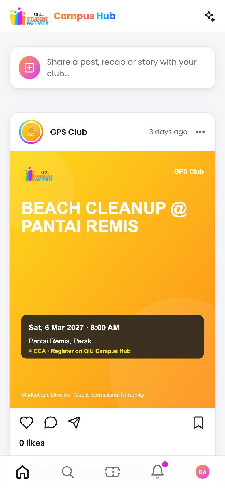 | 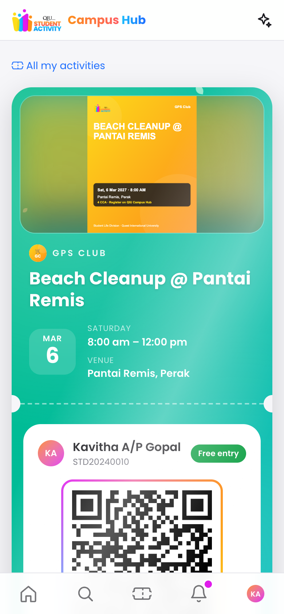 | 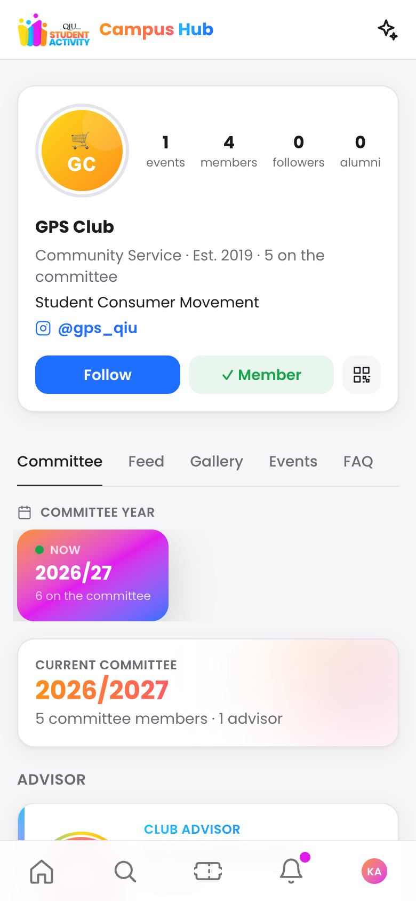 |

| AGM: the year in review, compiled automatically |
| :---: |
| 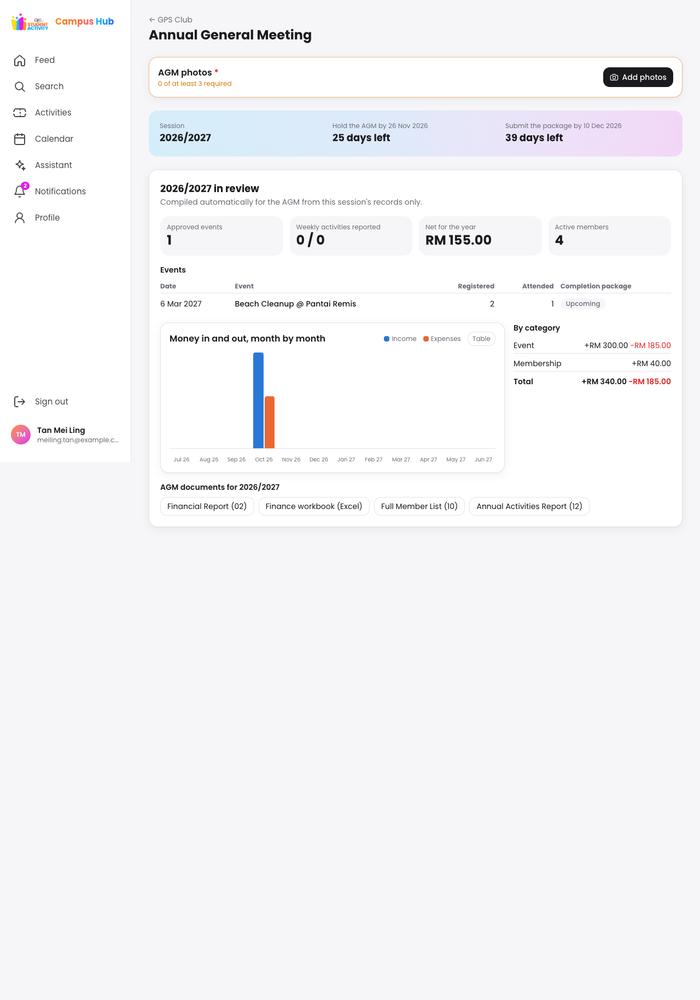 |

| SLD submissions tracker | SLD club finance |
| :---: | :---: |
| 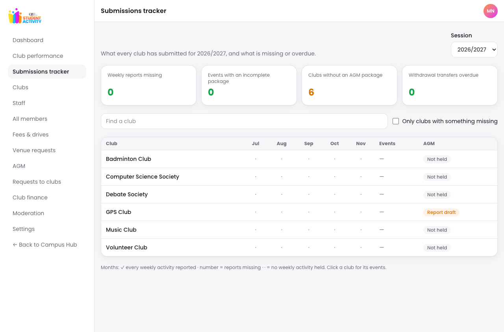 | 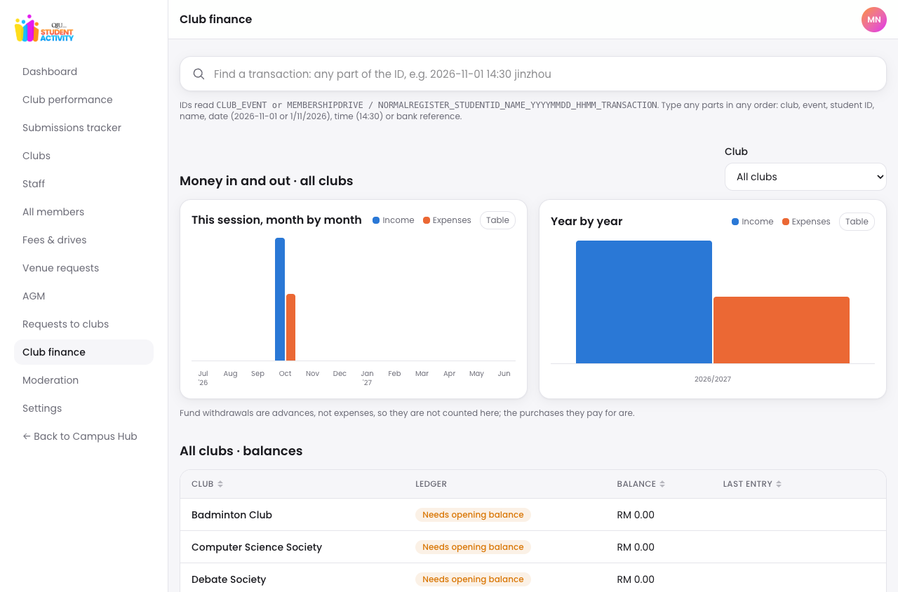 |

| SLD view of a club's members and committee fees | Role-aware assistant |
| :---: | :---: |
| 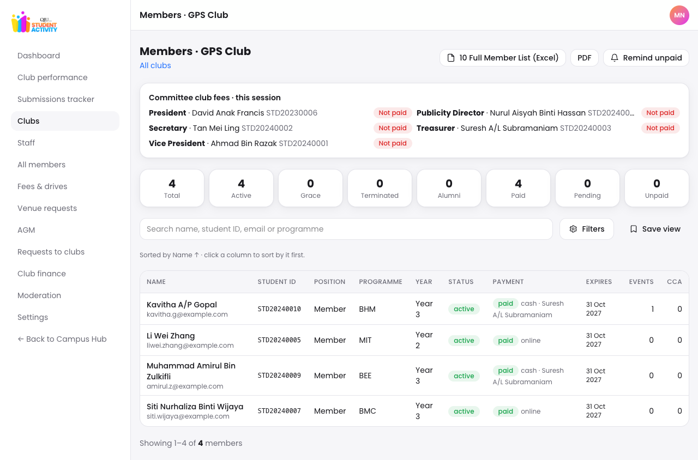 | 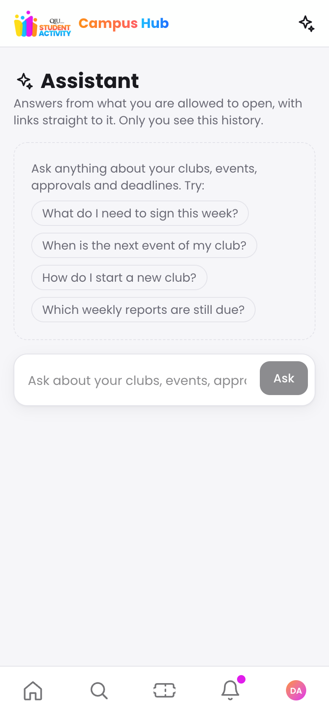 |

## How it works

### An event, from idea to archive

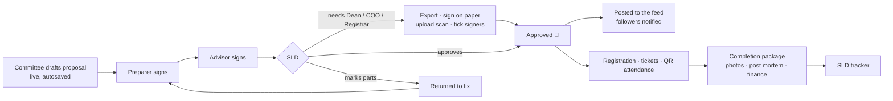

A late proposal (under the 14-day lead time) or a budget deficit needs a written reason, and SLD must approve it explicitly. That decision is recorded with the signature.

### A club's year

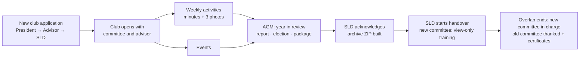

### Money

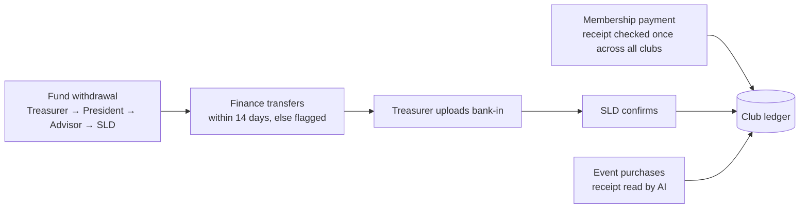

### Architecture

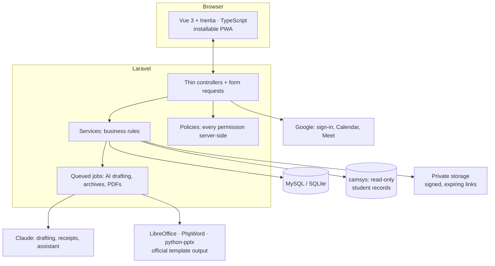

## Features

**Social (students)**
- Club profiles with logo, category, bio, Instagram, permanent club QR
- Committee tab with session selector: photo, position, course short form, year group; tap for profile card
- Lifelong student profile with a personal permanent QR (portfolio fields only)
- News feed: last 7 days in full, older posts folded into 8–14 days, months and years; followers notified of new posts and events; likes and comments (who liked, who commented) notify the committee
- Feed hygiene: bad-word and insult filter (English, Malay, Manglish, leet/spaced spellings), per-club and per-event posting limits, no repeat captions or comment floods
- Committee year timeline on the club page

**Portal (committees, advisors, SLD)**
- Google sign-in restricted to `@qiu.edu.my`, matched against the university student system (camsys)
- Nightly camsys sync (read-only) with automatic year group and academic session rollover (1 July)
- Scoped roles: club committee and advisor per session; President, Vice President, Secretary and Treasurer compulsory before any submission
- SLD admin: dashboard, clubs, committees, staff accounts, transfer club to committee, requests to clubs (7-working-day replies), settings, audit log
- Daily reminders for every deadline (approvals, proposal lead time, indemnity, post-event documents, membership grace, AGM, replies to SLD)
- Lifelong profile with CCA, positions, verifiable PDF certificates; alumni sign in with a linked personal email
- Installable PWA (manifest, offline shell); photos re-encoded on upload; private files behind signed, expiring links
- Event proposals with approval chains and e-signatures, QR attendance, indemnity, posters, post mortem (09)
- Membership and payments (online receipt check, cash handover), finance ledger (02) and fund withdrawal (07)
- One receipt pays once: screenshot fingerprint and bank transaction ID checked across every club; sender name checked
- Transaction IDs `CLUB_EVENT|MEMBERSHIPDRIVE-<drive>|NORMALREGISTER_MATRIC_NAME_YYYYMMDD_HHMM_TRANSACTION`; SLD finds any transaction by any parts as they type
- Finance workbook (Excel/PDF): Overview, then membership drive, normal registration, each event, other; this session or all years; pick the sheets
- Event purchases and claims: snap the receipt (AI reads items and prices), budget vs spending, helpers claim back, event committee verifies, pay back by cash (QR photo) or transfer (name checked)
- Outdoor events: indemnity pre-filled, sign once registered or paid, ticket appears after signing
- Meetings with Google Meet, minutes (13) with AI drafting, weekly CCA. Committee meetings invite the committee and advisors only; weekly activities invite the committee or all members, with expected pax and location, and everyone invited is notified
- Meeting check-in / check-out by rotating QR (like events): only the meeting's audience can check in (committee + advisors, or all members), with times kept per person
- Meetings report for each club and for SLD (every club), with attendance rate and minutes status, exported to Excel/PDF
- Membership grace, termination and alumni managed by the committee or SLD: remind, give more days, end with a reason, mark alumni, undo; members are notified
- Venue booking (La Place, semester venues, big rooms) with SLD confirmation; daily club status (Active / At risk / Inactive)
- AGM periods set by SLD, AGM scheduling with Meet link and rotating-QR attendance, AGM Report (01) with AI-drafted objectives/speech/agenda and computed attendance
- Elections: nominations with full-term check, one vote per position, SLD flags, results into the AGM Report, role handover on 1 July
- Annual Activities Report (12) as PPTX/PDF from the official template, AI-written event details, SLD themes; AGM package checklist
- Approval routes per the spec: proposals Preparer → Advisor → SLD (final); withdrawals Treasurer → President → Advisor → SLD, then Finance transfers and the Treasurer uploads the bank-in receipt
- SLD rules editable in Settings: proposal lead time (14 days), minimum photos (3), Finance transfer deadline (14 days), handover overlap (7 days). A late proposal or a budget deficit needs a reason that SLD explicitly approves, and the approval is recorded
- Evidence photos required for weekly activity reports, AGMs and finished events. Event photos download as a ZIP named `Club_Event_YYYYMMDD_01.jpg`
- After SLD acknowledges the AGM, a yearly archive ZIP is built (AGM, finance, members, annual report, events, weekly reports, photos), visible only to the club and SLD
- Handover started by SLD after the acknowledged AGM: the incoming committee gets view-only training access during the overlap
- Event proposal form: live gauge of the compulsory parts; Sign & submit jumps to the first problem (flashes red) and then to each next one (blinks until touched); workshops list speakers (photo required) and need only 2 persons in charge; at least 2 objectives; collaboration with partner clubs or typed-in partners; several trips, each departure → places on the way (last = drop-off) → return, all within the event time; extra headings, paragraphs, bullets, tables and pictures (printed centred, fitted for A4) after the conclusion; unticked ICT prints "Not required"; the export adds a committee chart with student and employee IDs
- Clubs you run → All events: ongoing, upcoming and past events, with past events by year
- SLD Proposals & exports: every proposal as PDF or Word, the list as Excel/PDF, and one ZIP per event with all its documents and finance lines
- My Activities: each club's requests by stage (Draft, Submitted with approval progress, Approved, Rejected); rejected requests clear after 30 days or by hand. Approvers, Treasurers (receipts to check) and the committee (proposal submitted) are notified
- SLD submissions tracker: weekly reports missing by month, incomplete event completion packages, AGM state, overdue transfers. Finance has monthly and yearly income/expense charts for one club or all clubs
- One calendar: approved events plus my meetings, weekly activities, weekly-report due dates and AGMs, with a whole-year view
- New-club registration: the proposed President applies and signs → the advisor signs → SLD approves. The club, its committee and its advisor only exist after approval
- Role-aware assistant: answers only from records the person may open, links to them, and keeps a private history the person can delete
- Report and long forms save drafts automatically (on the server for reports, on the device for new requests); every submission ends with one sign-and-confirm step
- Higher-authority signatures on paper at SLD's step: choose the signatories, export the official document, upload the signed scan and tick who signed. The final approval opens only when everyone is ticked, and it ends with an approval animation
- AGM "year in review" compiled automatically for that session only: events with turnout and completion state, weekly activities, money by month and category, and every AGM document
- When the handover overlap ends, the outgoing committee loses access and each member gets a thank-you and their committee certificate
- SLD views a club's members and committee fee status (paid, not paid, being checked) inside the admin portal; advisors and committees see the same on the club page
- Light and dark mode belong to each account, never the device, so a shared phone never shows the previous person's theme
- Moderation for posts, comments and assistant questions: a word filter that sees through disguises (f_u_c_k, f*u*c*k, fvck, run-together words) with English, Malay, Manglish and dialect slang, then the [toxic-comment model](https://huggingface.co/martin-ha/toxic-comment-model) (set `HF_TOKEN`). Only SLD and the club's committee can delete comments
- The assistant answers by retrieval from role-scoped facts: fees and approved events for everyone; a club's money, payments and reports only for that club's committee and advisor; everything for SLD. It suggests related follow-up questions and asks when a request is unclear

## Tech stack

| Layer | Choice |
| --- | --- |
| Backend | Laravel 13, PHP 8.3+ |
| Frontend | Vue 3 (TypeScript) + Inertia.js, Tailwind CSS 4, Vite |
| Database | MariaDB / MySQL (production), SQLite (local) |
| Auth | Google OAuth (Laravel Socialite), spatie/laravel-permission |
| Documents | PhpWord, PhpSpreadsheet, python-pptx, LibreOffice headless |
| Tests | Pest |

**Backend choice vs the original tech spec.** The spec named a Python backend with MySQL. This project uses Laravel (PHP) with MySQL/MariaDB in production and SQLite locally. It covers the same requirements:
- The same relational database design.
- The same REST-style endpoints, served through Inertia.
- Background jobs and a daily scheduler.
- Python is still used where it is the better tool (`python-pptx` for the annual report).

Rewriting the backend in Python would change nothing for users and would put the tested behaviour at risk (over 1,500 automated tests), so no rewrite is planned.

## Getting started

Requirements: PHP 8.3+, Composer, Node 20+, LibreOffice (PDFs), Python 3 with python-pptx (Annual Activities Report: `python3 -m venv tools/pptx/.venv && tools/pptx/.venv/bin/pip install python-pptx`).

```bash
composer install && npm install
cp .env.example .env && php artisan key:generate
touch database/database.sqlite database/camsys.sqlite
php artisan camsys:import-dump          # local camsys copy from the sample dump
php artisan migrate --seed              # roles, lookups, staff, 6 demo clubs
composer run dev                        # or: php artisan serve + npm run dev
```

- **Local sign-in without Google:** open `/dev/login-as` (registered only when `APP_ENV=local`).
- **Super Admin:** add your email to `SUPERADMIN_EMAILS` in `.env`.
- **Google sign-in:** create an OAuth client (Web) in Google Cloud, set the redirect URI to `${APP_URL}/auth/google/callback`, then fill `GOOGLE_CLIENT_ID` / `GOOGLE_CLIENT_SECRET`.

## Tests

```bash
composer test     # Pest
npm run build     # vue-tsc type-check + Vite build
php artisan test --group=hard-audit  # role matrices, input boundaries, receipts and adversarial workflow checks
php artisan test --group=deep-uat  # multi-task permutations, moderation, profile privacy, query fuzzing and account revocation
node --test tests/Frontend/deep-contracts.mjs  # execute actual theme, calendar and navigation scripts without a browser
SLD_UAT=1 php artisan test --group=combined-uat  # 3,000 joins, payments, connected event/AGM journeys and native exports
QA_TEMPLATES=1 php artisan test --filter=TemplateFidelity   # every official template → storage/qa/ side by side

# The same suites on MySQL (what Exabytes runs). Tests only ever use :memory: or a database named *_test.
mysql -uroot -e "CREATE DATABASE sld_test CHARACTER SET utf8mb4 COLLATE utf8mb4_unicode_ci"
DB_CONNECTION=mysql DB_HOST=127.0.0.1 DB_DATABASE=sld_test DB_USERNAME=root DB_PASSWORD= php artisan test
```

Deploying to Exabytes (cPanel or VPS): see [docs/DEPLOY_EXABYTES.md](docs/DEPLOY_EXABYTES.md); `scripts/package-exabytes.sh` builds the upload ZIP.

The hard-audit tests use the in-memory test databases and fake upload disks. They cover access, payment, withdrawal and signature boundaries and all pass; a future failure is evidence to investigate, not a reason to weaken the expected boundary. They do not perform live Google sign-in, bank transfers, browser/camera testing or concurrent load testing.

Combined UAT is opt-in and uses the same isolated databases/disks. It issues over 5,000 sequential in-process requests, retains dummy Excel/Word/PowerPoint exports and reconciliation JSON under `/private/tmp/sld-uat-20261102`, and checks advances versus purchases, empty workbooks and formula injection. Receipt OCR is mocked; QR photo decoding, approval signatures and exports use the application code. This is workflow/volume testing, not a concurrent production benchmark. All scenarios pass.

Cash-payment camera regressions: `node --test tests/Frontend/cash-camera.mjs` covers generated camera IDs, duplicate captures, incorrect QR codes and camera cleanup in both frontends. Test camera permission and capture on a real phone over HTTPS before release.

Deep UAT covers workflow and privacy boundaries (moderation, public profiles, query fuzzing, approvals bound to the signed version, cancellations, account revocation); all cases pass. Frontend contract tests execute the actual calendar, theme and navigation scripts with boundary stubs; they do not verify rendered layouts, keyboard focus, touch interaction or accessibility. Run browser/device UAT separately before release.

## Security and privacy

Everything sensitive stays on the server:

- **Secrets** (Google client secret, AI keys, DB credentials) live only in `.env`, read via `config()`. Only `VITE_APP_NAME` is exposed to the browser.
- **camsys is read-only:** the sync issues `SELECT` only and copies an allow-list of columns. IC/passport, address, religion, race, CGPA and scores are never read (enforced by tests).
- **Personal data:** student phone numbers are encrypted at rest; phone and email are hidden from serialisation; public profiles show portfolio fields only.
- **Authorisation** is enforced server-side (policies, form requests, role middleware). The UI never decides access.
- **AI calls** run server-side in queued jobs only, with minimal data.
- Sign-in is rate-limited, every feature has its own limit, and every request has a site-wide ceiling (per person or IP); every role, committee and membership change is written to the audit log.
- **Browser hardening:** a strict Content-Security-Policy (scripts only from this site, by nonce), no framing, HSTS, no-sniff, server version hidden; hidden files and scripts in the uploads folder are never served.
- **Demo login** (`DEMO_LOGIN`) is for testing only. On a hosted server it is locked behind a passcode (`DEMO_LOGIN_PASSCODE_HASH`, a bcrypt hash) and the account list is never sent before it is entered. Keep it off in production.
- The sample `database/camsys/*.sql` is **dummy data**. Never commit real student records.

## Roadmap

- [x] Phase 0: Laravel setup, design system, layouts
- [x] Phase 1: Login, camsys sync, roles, clubs, profiles
- [x] Phase 2: Feed, events, proposals, approvals, attendance, indemnity
- [x] Phase 3: Membership, payments, finance, meetings, minutes, post mortem, venues
- [x] Phase 4: AGM, elections, Annual Activities Report
- [x] Phase 5: Dashboards, reminders, hardening, pilot

Guides: [SLD admin](docs/ADMIN_GUIDE.md) · [Committees](docs/COMMITTEE_GUIDE.md) · [Pilot checklist](docs/PILOT.md) · [Template fidelity check](docs/QA_TEMPLATES.md)

## Project layout

```text
app/Services/            business rules (Camsys, Time, Roles, Profiles, ...)
app/Http/                thin controllers, form requests, middleware
database/camsys/         camsys sample dump (dummy data)
resources/templates/     original/ official SLD templates (never edited), filled/, maps/
resources/js/            Components/ui design system, Layouts, Pages
public/brand/            QIU Student Activity logos and guides
tests/                   Pest unit + feature tests
```
