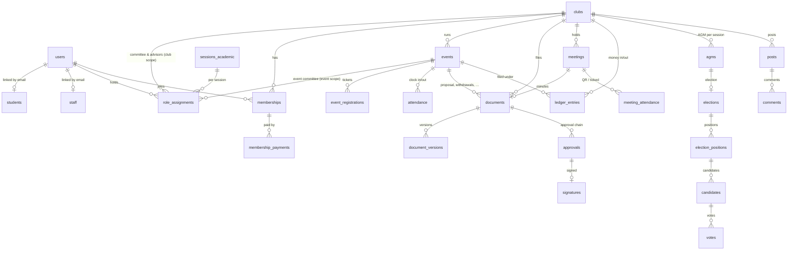

# Database schema (MySQL)

The QIU SLD Campus Hub stores everything in **one MySQL 8 database** (utf8mb4). Laravel migrations in `database/migrations` are the source of truth; this page is generated from a fresh `php artisan migrate` on MySQL.

**81 tables · 763 columns · 149 foreign keys.**

## How it fits together

## Rules that keep data safe

- **Money is stored in sen** (integer `*_sen` columns), never as floating point.
- **Personal data**: student phone numbers and payee bank details are encrypted at rest (Laravel encrypted casts); Google tokens are encrypted and hidden.
- **camsys is read-only**: `students` is a copy of an allow-list of columns from the university system; IC/passport, address, race, religion and grades are never stored.
- **Signatures** store the drawn image and the stroke data, a server timestamp and a verification code; documents keep every submitted version.
- **Foreign keys** cascade where the child has no meaning alone (e.g. a meeting's attendance) and are set to null where history must survive (e.g. the person who handled a payment).
- **Clean install**: `database/schema/install.sql` in the deployment package is this schema plus only the Super Admin, the SLD Officer, the four account roles, the student-status map, intake months and club categories. No demo data. It contains no `DROP` statements: import it into an empty database; if a table already exists the import stops and nothing is overwritten.

## People & access

Sign-in accounts, the read-only copy of university student records (camsys), staff, account roles (spatie/permission, team 0 = account-wide) and club/event roles per academic session.

### `users`

| Column | Type | Null | Default | Key |
|---|---|---|---|---|
| `id` | bigint unsigned | no |  | PK auto |
| `name` | varchar(255) | no |  |  |
| `email` | varchar(255) | no |  | unique |
| `google_id` | varchar(255) | yes |  | unique |
| `avatar_url` | varchar(2048) | yes |  |  |
| `avatar_path` | varchar(255) | yes |  |  |
| `cover_path` | varchar(255) | yes |  |  |
| `personal_email` | varchar(255) | yes |  | unique |
| `hidden_sections` | json | yes |  |  |
| `notification_mutes` | json | yes |  |  |
| `qr_token` | varchar(32) | no |  | unique |
| `last_login_at` | timestamp | yes |  |  |
| `remember_token` | varchar(100) | yes |  |  |
| `created_at` | timestamp | yes |  |  |
| `updated_at` | timestamp | yes |  |  |
| `google_token` | text | yes |  |  |
| `google_refresh_token` | text | yes |  |  |
| `google_token_expires_at` | timestamp | yes |  |  |
| `theme` | varchar(8) | no | system |  |
| `tours_seen` | json | yes |  |  |

### `students`

| Column | Type | Null | Default | Key |
|---|---|---|---|---|
| `id` | bigint unsigned | no |  | PK auto |
| `student_number` | varchar(50) | no |  | unique |
| `user_id` | bigint unsigned | yes |  | unique |
| `name` | varchar(255) | no |  |  |
| `email` | varchar(255) | no |  | index |
| `gender` | varchar(20) | yes |  |  |
| `mobile_no` | text | yes |  |  |
| `programme` | varchar(255) | no |  |  |
| `programme_code` | varchar(50) | no |  | index |
| `type_of_programme` | varchar(50) | yes |  |  |
| `programme_status` | varchar(50) | no |  |  |
| `profile_status` | varchar(50) | yes |  |  |
| `year_entry` | smallint unsigned | no |  |  |
| `intake_number` | tinyint unsigned | yes |  |  |
| `intake_month` | tinyint unsigned | yes |  |  |
| `course_duration` | varchar(30) | yes |  |  |
| `expected_end_date` | date | yes |  |  |
| `status` | varchar(10) | no |  | index |
| `year_group` | varchar(12) | yes |  |  |
| `synced_at` | timestamp | no |  |  |
| `created_at` | timestamp | yes |  |  |
| `updated_at` | timestamp | yes |  |  |

Foreign keys: `user_id` → `users.id` (on delete set null).

### `staff`

| Column | Type | Null | Default | Key |
|---|---|---|---|---|
| `id` | bigint unsigned | no |  | PK auto |
| `user_id` | bigint unsigned | yes |  | unique |
| `email` | varchar(255) | no |  | unique |
| `staff_number` | varchar(50) | yes |  |  |
| `name` | varchar(255) | no |  |  |
| `title` | varchar(255) | yes |  |  |
| `department` | varchar(255) | yes |  |  |
| `approver_role` | varchar(30) | yes |  | index |
| `active` | tinyint(1) | no | 1 |  |
| `created_at` | timestamp | yes |  |  |
| `updated_at` | timestamp | yes |  |  |

Foreign keys: `user_id` → `users.id` (on delete set null).

### `emergency_contacts`

| Column | Type | Null | Default | Key |
|---|---|---|---|---|
| `id` | bigint unsigned | no |  | PK auto |
| `user_id` | bigint unsigned | no |  | unique |
| `name` | varchar(255) | no |  |  |
| `mobile_phone` | text | no |  |  |
| `work_phone` | text | yes |  |  |
| `relationship` | varchar(50) | no |  |  |
| `alternate_name` | varchar(255) | yes |  |  |
| `alternate_phone` | text | yes |  |  |
| `created_at` | timestamp | yes |  |  |
| `updated_at` | timestamp | yes |  |  |

Foreign keys: `user_id` → `users.id` (on delete cascade).

### `roles`

| Column | Type | Null | Default | Key |
|---|---|---|---|---|
| `id` | bigint unsigned | no |  | PK auto |
| `team_id` | bigint unsigned | yes |  | index |
| `name` | varchar(255) | no |  |  |
| `guard_name` | varchar(255) | no |  |  |
| `created_at` | timestamp | yes |  |  |
| `updated_at` | timestamp | yes |  |  |

### `permissions`

| Column | Type | Null | Default | Key |
|---|---|---|---|---|
| `id` | bigint unsigned | no |  | PK auto |
| `name` | varchar(255) | no |  | index |
| `guard_name` | varchar(255) | no |  |  |
| `created_at` | timestamp | yes |  |  |
| `updated_at` | timestamp | yes |  |  |

### `model_has_roles`

| Column | Type | Null | Default | Key |
|---|---|---|---|---|
| `role_id` | bigint unsigned | no |  | PK |
| `model_type` | varchar(255) | no |  | PK |
| `model_id` | bigint unsigned | no |  | PK |
| `team_id` | bigint unsigned | no |  | PK |

Foreign keys: `role_id` → `roles.id` (on delete cascade).

### `model_has_permissions`

| Column | Type | Null | Default | Key |
|---|---|---|---|---|
| `permission_id` | bigint unsigned | no |  | PK |
| `model_type` | varchar(255) | no |  | PK |
| `model_id` | bigint unsigned | no |  | PK |
| `team_id` | bigint unsigned | no |  | PK |

Foreign keys: `permission_id` → `permissions.id` (on delete cascade).

### `role_has_permissions`

| Column | Type | Null | Default | Key |
|---|---|---|---|---|
| `permission_id` | bigint unsigned | no |  | PK |
| `role_id` | bigint unsigned | no |  | PK |

Foreign keys: `permission_id` → `permissions.id` (on delete cascade); `role_id` → `roles.id` (on delete cascade).

### `role_assignments`

| Column | Type | Null | Default | Key |
|---|---|---|---|---|
| `id` | bigint unsigned | no |  | PK auto |
| `user_id` | bigint unsigned | no |  | index |
| `role` | varchar(30) | no |  |  |
| `scope_type` | varchar(10) | no |  | index |
| `scope_id` | bigint unsigned | yes |  |  |
| `session_id` | bigint unsigned | yes |  | index |
| `position` | varchar(100) | yes |  |  |
| `responsibility` | varchar(255) | yes |  |  |
| `is_compulsory` | tinyint(1) | no | 0 |  |
| `starts_on` | date | yes |  |  |
| `ends_on` | date | yes |  |  |
| `handover_state` | varchar(10) | yes |  |  |
| `created_at` | timestamp | yes |  |  |
| `updated_at` | timestamp | yes |  |  |

Foreign keys: `session_id` → `sessions_academic.id` (on delete restrict); `user_id` → `users.id` (on delete cascade).

### `sessions_academic`

| Column | Type | Null | Default | Key |
|---|---|---|---|---|
| `id` | bigint unsigned | no |  | PK auto |
| `name` | varchar(9) | no |  | unique |
| `starts_on` | date | no |  |  |
| `ends_on` | date | no |  |  |
| `created_at` | timestamp | yes |  |  |
| `updated_at` | timestamp | yes |  |  |

### `intake_map`

| Column | Type | Null | Default | Key |
|---|---|---|---|---|
| `intake_number` | tinyint unsigned | no |  | PK |
| `month` | tinyint unsigned | no |  |  |
| `created_at` | timestamp | yes |  |  |
| `updated_at` | timestamp | yes |  |  |

### `programme_abbrev`

| Column | Type | Null | Default | Key |
|---|---|---|---|---|
| `programme_code` | varchar(50) | no |  | PK |
| `abbreviation` | varchar(20) | no |  |  |
| `created_at` | timestamp | yes |  |  |
| `updated_at` | timestamp | yes |  |  |

### `camsys_sync_runs`

| Column | Type | Null | Default | Key |
|---|---|---|---|---|
| `id` | bigint unsigned | no |  | PK auto |
| `trigger` | varchar(10) | no |  |  |
| `triggered_by` | bigint unsigned | yes |  | index |
| `records_seen` | int unsigned | no | 0 |  |
| `upserted` | int unsigned | no | 0 |  |
| `error` | text | yes |  |  |
| `started_at` | timestamp | no |  |  |
| `finished_at` | timestamp | yes |  |  |

Foreign keys: `triggered_by` → `users.id` (on delete set null).

## Clubs

Clubs, their categories, followers, FAQs, applications to start a new club and SLD requests to clubs.

### `clubs`

| Column | Type | Null | Default | Key |
|---|---|---|---|---|
| `id` | bigint unsigned | no |  | PK auto |
| `name` | varchar(255) | no |  |  |
| `slug` | varchar(255) | no |  | unique |
| `logo_path` | varchar(255) | yes |  |  |
| `category_id` | bigint unsigned | yes |  | index |
| `established_year` | smallint unsigned | yes |  |  |
| `bio` | text | yes |  |  |
| `instagram_handle` | varchar(30) | yes |  |  |
| `qr_token` | varchar(32) | no |  | unique |
| `managed_by` | varchar(10) | no | sld |  |
| `status` | varchar(10) | no | active | index |
| `last_activity_at` | timestamp | yes |  |  |
| `transferred_at` | timestamp | yes |  |  |
| `created_at` | timestamp | yes |  |  |
| `updated_at` | timestamp | yes |  |  |

Foreign keys: `category_id` → `club_categories.id` (on delete set null).

### `club_categories`

| Column | Type | Null | Default | Key |
|---|---|---|---|---|
| `id` | bigint unsigned | no |  | PK auto |
| `name` | varchar(100) | no |  | unique |
| `created_at` | timestamp | yes |  |  |
| `updated_at` | timestamp | yes |  |  |

### `club_follows`

| Column | Type | Null | Default | Key |
|---|---|---|---|---|
| `club_id` | bigint unsigned | no |  | PK |
| `user_id` | bigint unsigned | no |  | PK |
| `created_at` | timestamp | no | CURRENT_TIMESTAMP |  |

Foreign keys: `club_id` → `clubs.id` (on delete cascade); `user_id` → `users.id` (on delete cascade).

### `club_faqs`

| Column | Type | Null | Default | Key |
|---|---|---|---|---|
| `id` | bigint unsigned | no |  | PK auto |
| `club_id` | bigint unsigned | no |  | index |
| `question` | varchar(255) | no |  |  |
| `answer` | text | no |  |  |
| `sort` | smallint unsigned | no | 0 |  |
| `created_at` | timestamp | yes |  |  |
| `updated_at` | timestamp | yes |  |  |

Foreign keys: `club_id` → `clubs.id` (on delete cascade).

### `club_applications`

| Column | Type | Null | Default | Key |
|---|---|---|---|---|
| `id` | bigint unsigned | no |  | PK auto |
| `applicant_id` | bigint unsigned | no |  | index |
| `advisor_id` | bigint unsigned | no |  | index |
| `data` | json | no |  |  |
| `status` | varchar(20) | no |  | index |
| `applicant_signature_id` | bigint unsigned | yes |  | index |
| `advisor_signature_id` | bigint unsigned | yes |  | index |
| `advisor_signed_at` | timestamp | yes |  |  |
| `decided_by` | bigint unsigned | yes |  | index |
| `decided_at` | timestamp | yes |  |  |
| `note` | varchar(1000) | yes |  |  |
| `club_id` | bigint unsigned | yes |  | index |
| `created_at` | timestamp | yes |  |  |
| `updated_at` | timestamp | yes |  |  |

Foreign keys: `advisor_id` → `users.id` (on delete cascade); `advisor_signature_id` → `signatures.id` (on delete set null); `applicant_id` → `users.id` (on delete cascade); `applicant_signature_id` → `signatures.id` (on delete set null); `club_id` → `clubs.id` (on delete set null); `decided_by` → `users.id` (on delete set null).

### `sld_requests`

| Column | Type | Null | Default | Key |
|---|---|---|---|---|
| `id` | bigint unsigned | no |  | PK auto |
| `club_id` | bigint unsigned | no |  | index |
| `created_by` | bigint unsigned | no |  | index |
| `subject` | varchar(200) | no |  |  |
| `body` | text | no |  |  |
| `due_on` | date | no |  | index |
| `reply` | text | yes |  |  |
| `replied_by` | bigint unsigned | yes |  | index |
| `replied_at` | timestamp | yes |  | index |
| `created_at` | timestamp | yes |  |  |
| `updated_at` | timestamp | yes |  |  |

Foreign keys: `club_id` → `clubs.id` (on delete cascade); `created_by` → `users.id` (on delete restrict); `replied_by` → `users.id` (on delete set null).

### `saved_views`

| Column | Type | Null | Default | Key |
|---|---|---|---|---|
| `id` | bigint unsigned | no |  | PK auto |
| `user_id` | bigint unsigned | no |  | index |
| `page` | varchar(30) | no |  |  |
| `name` | varchar(60) | no |  |  |
| `filters` | json | no |  |  |
| `created_at` | timestamp | yes |  |  |
| `updated_at` | timestamp | yes |  |  |

Foreign keys: `user_id` → `users.id` (on delete cascade).

## Membership & payments

Memberships (pending → active → grace → terminated / alumni), fees, drives, online and cash payments, cash handovers and receipts.

### `memberships`

| Column | Type | Null | Default | Key |
|---|---|---|---|---|
| `id` | bigint unsigned | no |  | PK auto |
| `club_id` | bigint unsigned | no |  | index |
| `user_id` | bigint unsigned | no |  | index |
| `status` | varchar(12) | no |  | index |
| `starts_on` | date | yes |  |  |
| `expires_on` | date | yes |  | index |
| `grace_ends_on` | date | yes |  |  |
| `alumni_since` | date | yes |  |  |
| `acknowledged_at` | timestamp | yes |  |  |
| `last_reminded_at` | timestamp | yes |  |  |
| `created_at` | timestamp | yes |  |  |
| `updated_at` | timestamp | yes |  |  |

Foreign keys: `club_id` → `clubs.id` (on delete cascade); `user_id` → `users.id` (on delete cascade).

### `club_fees`

| Column | Type | Null | Default | Key |
|---|---|---|---|---|
| `id` | bigint unsigned | no |  | PK auto |
| `club_id` | bigint unsigned | no |  | index |
| `session_id` | bigint unsigned | no |  | index |
| `amount_sen` | int unsigned | no |  |  |
| `payment_url` | varchar(1024) | yes |  |  |
| `account_name` | varchar(255) | yes |  |  |
| `payment_qr_paths` | json | yes |  |  |
| `set_by` | bigint unsigned | no |  | index |
| `approved_by` | bigint unsigned | yes |  | index |
| `approved_at` | timestamp | yes |  |  |
| `created_at` | timestamp | yes |  |  |
| `updated_at` | timestamp | yes |  |  |

Foreign keys: `approved_by` → `users.id` (on delete set null); `club_id` → `clubs.id` (on delete cascade); `session_id` → `sessions_academic.id` (on delete restrict); `set_by` → `users.id` (on delete restrict).

### `membership_drives`

| Column | Type | Null | Default | Key |
|---|---|---|---|---|
| `id` | bigint unsigned | no |  | PK auto |
| `club_id` | bigint unsigned | yes |  | index |
| `title` | varchar(255) | no |  |  |
| `starts_at` | datetime | no |  | index |
| `ends_at` | datetime | no |  |  |
| `set_by` | bigint unsigned | no |  | index |
| `created_at` | timestamp | yes |  |  |
| `updated_at` | timestamp | yes |  |  |

Foreign keys: `club_id` → `clubs.id` (on delete cascade); `set_by` → `users.id` (on delete restrict).

### `membership_payments`

| Column | Type | Null | Default | Key |
|---|---|---|---|---|
| `id` | bigint unsigned | no |  | PK auto |
| `order_id` | varchar(255) | yes |  | unique |
| `membership_id` | bigint unsigned | yes |  | index |
| `event_id` | bigint unsigned | yes |  | index |
| `event_registration_id` | bigint unsigned | yes |  | index |
| `club_id` | bigint unsigned | no |  | index |
| `user_id` | bigint unsigned | no |  | index |
| `method` | varchar(8) | no |  |  |
| `amount_sen` | int unsigned | no |  |  |
| `reference` | varchar(100) | yes |  | index |
| `reference_key` | varchar(60) | yes |  | index |
| `receipt_path` | varchar(255) | yes |  |  |
| `receipt_hash` | char(64) | yes |  | index |
| `ai_amount_sen` | int unsigned | yes |  |  |
| `ai_date` | date | yes |  |  |
| `ai_reference` | varchar(100) | yes |  |  |
| `ai_payee` | varchar(255) | yes |  |  |
| `ai_payer` | varchar(150) | yes |  |  |
| `ai_confidence` | decimal(3,2) | yes |  |  |
| `flags` | json | yes |  |  |
| `status` | varchar(16) | no |  | index |
| `review_note` | varchar(500) | yes |  |  |
| `collected_by` | bigint unsigned | yes |  | index |
| `verified_by` | bigint unsigned | yes |  | index |
| `verified_at` | timestamp | yes |  |  |
| `created_at` | timestamp | yes |  |  |
| `updated_at` | timestamp | yes |  |  |

Foreign keys: `club_id` → `clubs.id` (on delete cascade); `collected_by` → `users.id` (on delete set null); `event_id` → `events.id` (on delete set null); `event_registration_id` → `event_registrations.id` (on delete set null); `membership_id` → `memberships.id` (on delete cascade); `user_id` → `users.id` (on delete cascade); `verified_by` → `users.id` (on delete set null).

### `cash_handovers`

| Column | Type | Null | Default | Key |
|---|---|---|---|---|
| `id` | bigint unsigned | no |  | PK auto |
| `payment_id` | bigint unsigned | no |  | unique |
| `student_id` | bigint unsigned | no |  | index |
| `committee_user_id` | bigint unsigned | no |  | index |
| `status` | varchar(16) | no |  | index |
| `qr_token_hash` | varchar(64) | yes |  |  |
| `photo_path` | varchar(255) | yes |  |  |
| `cash_check` | varchar(24) | yes |  |  |
| `accepted_at` | timestamp | yes |  |  |
| `declined_at` | timestamp | yes |  |  |
| `student_ready_at` | timestamp | yes |  |  |
| `committee_ready_at` | timestamp | yes |  |  |
| `photo_taken_at` | timestamp | yes |  |  |
| `student_done_at` | timestamp | yes |  |  |
| `committee_done_at` | timestamp | yes |  |  |
| `completed_at` | timestamp | yes |  |  |
| `expires_at` | timestamp | no |  |  |
| `created_at` | timestamp | yes |  |  |
| `updated_at` | timestamp | yes |  |  |

Foreign keys: `committee_user_id` → `users.id` (on delete cascade); `payment_id` → `membership_payments.id` (on delete cascade); `student_id` → `users.id` (on delete cascade).

### `committee_fee_reminders`

| Column | Type | Null | Default | Key |
|---|---|---|---|---|
| `id` | bigint unsigned | no |  | PK auto |
| `user_id` | bigint unsigned | no |  | index |
| `club_id` | bigint unsigned | no |  | index |
| `session_id` | bigint unsigned | no |  | index |
| `first_shown_at` | timestamp | no |  |  |

Foreign keys: `club_id` → `clubs.id` (on delete cascade); `session_id` → `sessions_academic.id` (on delete cascade); `user_id` → `users.id` (on delete cascade).

### `receipts`

| Column | Type | Null | Default | Key |
|---|---|---|---|---|
| `id` | bigint unsigned | no |  | PK auto |
| `club_id` | bigint unsigned | no |  | index |
| `path` | varchar(255) | no |  |  |
| `original_name` | varchar(255) | no |  |  |
| `uploaded_by` | bigint unsigned | no |  | index |
| `created_at` | timestamp | yes |  |  |
| `updated_at` | timestamp | yes |  |  |

Foreign keys: `club_id` → `clubs.id` (on delete cascade); `uploaded_by` → `users.id` (on delete restrict).

### `order_counters`

| Column | Type | Null | Default | Key |
|---|---|---|---|---|
| `prefix` | varchar(100) | no |  | PK |
| `last` | int unsigned | no | 0 |  |

## Events

Events, their committee and door helpers, registrations and tickets, attendance (QR clock-in/out), indemnities, purchases and post-event documents.

### `events`

| Column | Type | Null | Default | Key |
|---|---|---|---|---|
| `id` | bigint unsigned | no |  | PK auto |
| `club_id` | bigint unsigned | no |  | index |
| `session_id` | bigint unsigned | no |  | index |
| `name` | varchar(255) | no |  |  |
| `slug` | varchar(255) | no |  | unique |
| `summary` | text | yes |  |  |
| `starts_at` | datetime | no |  | index |
| `ends_at` | datetime | no |  |  |
| `venue` | varchar(255) | yes |  |  |
| `mode` | varchar(10) | no | physical |  |
| `expected_participants` | int unsigned | no | 0 |  |
| `fee_sen` | int unsigned | no | 0 |  |
| `payment_url` | varchar(500) | yes |  |  |
| `payment_account_name` | varchar(150) | yes |  |  |
| `payment_qr_paths` | json | yes |  |  |
| `is_outdoor` | tinyint(1) | no | 0 |  |
| `is_faculty_event` | tinyint(1) | no | 0 |  |
| `cca_participant` | decimal(5,1) | no | 0.0 |  |
| `cca_committee` | decimal(5,1) | no | 0.0 |  |
| `status` | varchar(12) | no | draft | index |
| `poster_path` | varchar(255) | yes |  |  |
| `poster_checklist` | json | yes |  |  |
| `registration_open` | tinyint(1) | no | 0 |  |
| `members_only` | tinyint(1) | no | 0 |  |
| `attendance_open` | tinyint(1) | no | 0 |  |
| `qr_rotate_seconds` | smallint unsigned | no | 60 |  |
| `attendance_secret` | varchar(64) | no |  |  |
| `approved_at` | timestamp | yes |  |  |
| `created_at` | timestamp | yes |  |  |
| `updated_at` | timestamp | yes |  |  |
| `checkin_qr_path` | varchar(255) | yes |  |  |
| `checkout_qr_path` | varchar(255) | yes |  |  |

Foreign keys: `club_id` → `clubs.id` (on delete cascade); `session_id` → `sessions_academic.id` (on delete restrict).

### `event_helpers`

| Column | Type | Null | Default | Key |
|---|---|---|---|---|
| `id` | bigint unsigned | no |  | PK auto |
| `event_id` | bigint unsigned | no |  | index |
| `user_id` | bigint unsigned | no |  | index |
| `added_by` | bigint unsigned | yes |  | index |
| `created_at` | timestamp | yes |  |  |
| `updated_at` | timestamp | yes |  |  |

Foreign keys: `added_by` → `users.id` (on delete set null); `event_id` → `events.id` (on delete cascade); `user_id` → `users.id` (on delete cascade).

### `event_registrations`

| Column | Type | Null | Default | Key |
|---|---|---|---|---|
| `id` | bigint unsigned | no |  | PK auto |
| `event_id` | bigint unsigned | no |  | index |
| `user_id` | bigint unsigned | no |  | index |
| `status` | varchar(16) | no | registered | index |
| `ticket_code` | varchar(40) | yes |  | unique |
| `order_id` | varchar(255) | yes |  |  |
| `paid_at` | timestamp | yes |  |  |
| `created_at` | timestamp | yes |  |  |
| `updated_at` | timestamp | yes |  |  |
| `deleted_at` | timestamp | yes |  |  |

Foreign keys: `event_id` → `events.id` (on delete cascade); `user_id` → `users.id` (on delete cascade).

### `attendance`

| Column | Type | Null | Default | Key |
|---|---|---|---|---|
| `id` | bigint unsigned | no |  | PK auto |
| `event_id` | bigint unsigned | no |  | index |
| `user_id` | bigint unsigned | no |  | index |
| `role` | varchar(12) | no |  |  |
| `clock_in_at` | timestamp | yes |  |  |
| `clock_out_at` | timestamp | yes |  |  |
| `method` | varchar(10) | no |  |  |
| `added_by` | bigint unsigned | yes |  | index |
| `created_at` | timestamp | yes |  |  |
| `updated_at` | timestamp | yes |  |  |

Foreign keys: `added_by` → `users.id` (on delete set null); `event_id` → `events.id` (on delete cascade); `user_id` → `users.id` (on delete cascade).

### `indemnities`

| Column | Type | Null | Default | Key |
|---|---|---|---|---|
| `id` | bigint unsigned | no |  | PK auto |
| `event_id` | bigint unsigned | no |  | index |
| `user_id` | bigint unsigned | no |  | index |
| `emergency_name` | varchar(255) | no |  |  |
| `emergency_mobile_phone` | text | no |  |  |
| `emergency_work_phone` | text | yes |  |  |
| `emergency_relationship` | varchar(50) | no |  |  |
| `alternate_name` | varchar(255) | yes |  |  |
| `alternate_phone` | text | yes |  |  |
| `contact_number` | text | no |  |  |
| `address` | text | no |  |  |
| `signature_id` | bigint unsigned | no |  | index |
| `signed_at` | timestamp | no |  |  |
| `created_at` | timestamp | yes |  |  |
| `updated_at` | timestamp | yes |  |  |

Foreign keys: `event_id` → `events.id` (on delete cascade); `signature_id` → `signatures.id` (on delete restrict); `user_id` → `users.id` (on delete cascade).

### `event_purchases`

| Column | Type | Null | Default | Key |
|---|---|---|---|---|
| `id` | bigint unsigned | no |  | PK auto |
| `event_id` | bigint unsigned | no |  | index |
| `club_id` | bigint unsigned | no |  | index |
| `bought_by` | bigint unsigned | no |  | index |
| `status` | varchar(16) | no |  | index |
| `paid_with` | varchar(8) | no | own |  |
| `budget_line` | varchar(255) | yes |  |  |
| `shop` | varchar(150) | yes |  |  |
| `purchased_on` | date | yes |  |  |
| `items` | json | yes |  |  |
| `total_sen` | int unsigned | no | 0 |  |
| `receipt_path` | varchar(255) | no |  |  |
| `receipt_hash` | char(64) | no |  | index |
| `ai_confidence` | double | yes |  |  |
| `verifier_id` | bigint unsigned | yes |  | index |
| `verified_at` | timestamp | yes |  |  |
| `review_note` | varchar(500) | yes |  |  |
| `settle_when` | varchar(12) | yes |  |  |
| `settle_method` | varchar(8) | yes |  |  |
| `paid_back_by` | bigint unsigned | yes |  | index |
| `payout_path` | varchar(255) | yes |  |  |
| `payout_payee` | varchar(150) | yes |  |  |
| `payout_reference` | varchar(100) | yes |  |  |
| `payout_check` | varchar(12) | yes |  |  |
| `received_at` | timestamp | yes |  |  |
| `ledger_entry_id` | bigint unsigned | yes |  | index |
| `created_at` | timestamp | yes |  |  |
| `updated_at` | timestamp | yes |  |  |

Foreign keys: `bought_by` → `users.id` (on delete cascade); `club_id` → `clubs.id` (on delete cascade); `event_id` → `events.id` (on delete cascade); `ledger_entry_id` → `ledger_entries.id` (on delete set null); `paid_back_by` → `users.id` (on delete set null); `verifier_id` → `users.id` (on delete set null).

### `event_document_items`

| Column | Type | Null | Default | Key |
|---|---|---|---|---|
| `id` | bigint unsigned | no |  | PK auto |
| `event_id` | bigint unsigned | no |  | index |
| `kind` | varchar(30) | no |  |  |
| `due_on` | date | no |  | index |
| `file_path` | varchar(255) | yes |  |  |
| `submitted_by` | bigint unsigned | yes |  | index |
| `submitted_at` | timestamp | yes |  |  |
| `reminded_at` | timestamp | yes |  |  |
| `created_at` | timestamp | yes |  |  |
| `updated_at` | timestamp | yes |  |  |

Foreign keys: `event_id` → `events.id` (on delete cascade); `submitted_by` → `users.id` (on delete set null).

### `certificates`

| Column | Type | Null | Default | Key |
|---|---|---|---|---|
| `id` | bigint unsigned | no |  | PK auto |
| `user_id` | bigint unsigned | no |  | index |
| `kind` | varchar(20) | no |  |  |
| `source_id` | bigint unsigned | no |  |  |
| `title` | varchar(255) | no |  |  |
| `statement` | varchar(500) | no |  |  |
| `code` | varchar(16) | no |  | unique |
| `issued_at` | timestamp | no |  |  |
| `created_at` | timestamp | yes |  |  |
| `updated_at` | timestamp | yes |  |  |

Foreign keys: `user_id` → `users.id` (on delete cascade).

### `cca_records`

| Column | Type | Null | Default | Key |
|---|---|---|---|---|
| `id` | bigint unsigned | no |  | PK auto |
| `user_id` | bigint unsigned | no |  | index |
| `event_id` | bigint unsigned | yes |  | index |
| `meeting_id` | bigint unsigned | yes |  | index |
| `session_id` | bigint unsigned | no |  | index |
| `role` | varchar(12) | no |  |  |
| `hours` | decimal(5,1) | no |  |  |
| `created_at` | timestamp | yes |  |  |
| `updated_at` | timestamp | yes |  |  |

Foreign keys: `event_id` → `events.id` (on delete cascade); `meeting_id` → `meetings.id` (on delete cascade); `session_id` → `sessions_academic.id` (on delete restrict); `user_id` → `users.id` (on delete cascade).

## Documents & approvals

Every SLD form (proposal, minutes, withdrawal, attendance list, post mortem, AGM report…), its versions, the approval chain and the drawn signatures (with verification codes).

### `documents`

| Column | Type | Null | Default | Key |
|---|---|---|---|---|
| `id` | bigint unsigned | no |  | PK auto |
| `type` | varchar(30) | no |  | index |
| `club_id` | bigint unsigned | no |  | index |
| `event_id` | bigint unsigned | yes |  | index |
| `meeting_id` | bigint unsigned | yes |  | index |
| `agm_id` | bigint unsigned | yes |  | index |
| `session_id` | bigint unsigned | no |  | index |
| `status` | varchar(12) | no | draft | index |
| `finance_stage` | varchar(20) | yes |  | index |
| `finance_file_path` | varchar(255) | yes |  |  |
| `bankin_path` | varchar(255) | yes |  |  |
| `bankin_reference` | varchar(100) | yes |  |  |
| `finance_note` | varchar(500) | yes |  |  |
| `created_by` | bigint unsigned | no |  | index |
| `submitted_at` | timestamp | yes |  |  |
| `decided_at` | timestamp | yes |  |  |
| `completed_at` | timestamp | yes |  |  |
| `created_at` | timestamp | yes |  |  |
| `updated_at` | timestamp | yes |  |  |

Foreign keys: `agm_id` → `agms.id` (on delete cascade); `club_id` → `clubs.id` (on delete cascade); `created_by` → `users.id` (on delete restrict); `event_id` → `events.id` (on delete cascade); `session_id` → `sessions_academic.id` (on delete restrict).

### `document_versions`

| Column | Type | Null | Default | Key |
|---|---|---|---|---|
| `id` | bigint unsigned | no |  | PK auto |
| `document_id` | bigint unsigned | no |  | index |
| `number` | smallint unsigned | no |  |  |
| `data` | json | no |  |  |
| `created_by` | bigint unsigned | no |  | index |
| `created_at` | timestamp | no | CURRENT_TIMESTAMP |  |

Foreign keys: `created_by` → `users.id` (on delete restrict); `document_id` → `documents.id` (on delete cascade).

### `approvals`

| Column | Type | Null | Default | Key |
|---|---|---|---|---|
| `id` | bigint unsigned | no |  | PK auto |
| `document_id` | bigint unsigned | no |  | index |
| `step_no` | tinyint unsigned | no |  |  |
| `role` | varchar(30) | no |  |  |
| `approver_user_id` | bigint unsigned | yes |  | index |
| `decision` | varchar(10) | no | pending | index |
| `comment` | text | yes |  |  |
| `sections` | json | yes |  |  |
| `paper` | json | yes |  |  |
| `paper_scan_path` | varchar(255) | yes |  |  |
| `due_at` | timestamp | yes |  |  |
| `decided_at` | timestamp | yes |  |  |
| `created_at` | timestamp | yes |  |  |
| `updated_at` | timestamp | yes |  |  |

Foreign keys: `approver_user_id` → `users.id` (on delete set null); `document_id` → `documents.id` (on delete cascade).

### `signatures`

| Column | Type | Null | Default | Key |
|---|---|---|---|---|
| `id` | bigint unsigned | no |  | PK auto |
| `document_id` | bigint unsigned | yes |  | index |
| `approval_id` | bigint unsigned | yes |  | index |
| `document_version_id` | bigint unsigned | yes |  | index |
| `user_id` | bigint unsigned | no |  | index |
| `signer_name` | varchar(255) | no |  |  |
| `position_at_time` | varchar(100) | no |  |  |
| `image_path` | varchar(255) | no |  |  |
| `strokes` | json | yes |  |  |
| `input_device` | varchar(10) | yes |  |  |
| `verification_code` | varchar(16) | no |  | unique |
| `signed_at` | timestamp | no |  |  |
| `created_at` | timestamp | yes |  |  |
| `updated_at` | timestamp | yes |  |  |

Foreign keys: `approval_id` → `approvals.id` (on delete set null); `document_id` → `documents.id` (on delete cascade); `document_version_id` → `document_versions.id` (on delete set null); `user_id` → `users.id` (on delete restrict).

### `generated_files`

| Column | Type | Null | Default | Key |
|---|---|---|---|---|
| `id` | bigint unsigned | no |  | PK auto |
| `club_id` | bigint unsigned | no |  | index |
| `session_id` | bigint unsigned | no |  | index |
| `kind` | varchar(32) | no |  |  |
| `data` | json | yes |  |  |
| `report_theme_id` | bigint unsigned | yes |  | index |
| `pptx_path` | varchar(255) | yes |  |  |
| `pdf_path` | varchar(255) | yes |  |  |
| `zip_path` | varchar(255) | yes |  |  |
| `generated_at` | timestamp | yes |  |  |
| `created_by` | bigint unsigned | no |  | index |
| `created_at` | timestamp | yes |  |  |
| `updated_at` | timestamp | yes |  |  |

Foreign keys: `club_id` → `clubs.id` (on delete cascade); `created_by` → `users.id` (on delete restrict); `report_theme_id` → `report_themes.id` (on delete set null); `session_id` → `sessions_academic.id` (on delete restrict).

### `report_photos`

| Column | Type | Null | Default | Key |
|---|---|---|---|---|
| `id` | bigint unsigned | no |  | PK auto |
| `photoable_type` | varchar(255) | no |  | index |
| `photoable_id` | bigint unsigned | no |  |  |
| `path` | varchar(255) | no |  |  |
| `uploaded_by` | bigint unsigned | yes |  | index |
| `created_at` | timestamp | yes |  |  |
| `updated_at` | timestamp | yes |  |  |

Foreign keys: `uploaded_by` → `users.id` (on delete set null).

### `report_themes`

| Column | Type | Null | Default | Key |
|---|---|---|---|---|
| `id` | bigint unsigned | no |  | PK auto |
| `name` | varchar(100) | no |  |  |
| `background_color` | varchar(7) | no | #FFFFFF |  |
| `title_color` | varchar(7) | no | #000000 |  |
| `body_color` | varchar(7) | no | #333333 |  |
| `font` | varchar(60) | no | Poppins |  |
| `background_path` | varchar(255) | yes |  |  |
| `is_default` | tinyint(1) | no | 0 |  |
| `created_at` | timestamp | yes |  |  |
| `updated_at` | timestamp | yes |  |  |

## Meetings & AGM

Committee meetings and weekly activities (audience, pax, rotating QR check-in/out), AGMs, elections, candidates and votes.

### `meetings`

| Column | Type | Null | Default | Key |
|---|---|---|---|---|
| `id` | bigint unsigned | no |  | PK auto |
| `club_id` | bigint unsigned | no |  | index |
| `session_id` | bigint unsigned | no |  | index |
| `kind` | varchar(12) | no |  |  |
| `audience` | varchar(20) | no | committee |  |
| `pax` | int unsigned | yes |  |  |
| `attendance_secret` | varchar(64) | yes |  |  |
| `title` | varchar(255) | no |  |  |
| `starts_at` | datetime | no |  |  |
| `ends_at` | datetime | no |  |  |
| `venue` | varchar(255) | yes |  |  |
| `meet_link` | varchar(500) | yes |  |  |
| `google_event_id` | varchar(255) | yes |  |  |
| `organiser_id` | bigint unsigned | no |  | index |
| `created_at` | timestamp | yes |  |  |
| `updated_at` | timestamp | yes |  |  |
| `checkin_qr_path` | varchar(255) | yes |  |  |
| `checkout_qr_path` | varchar(255) | yes |  |  |

Foreign keys: `club_id` → `clubs.id` (on delete cascade); `organiser_id` → `users.id` (on delete restrict); `session_id` → `sessions_academic.id` (on delete restrict).

### `meeting_attendance`

| Column | Type | Null | Default | Key |
|---|---|---|---|---|
| `meeting_id` | bigint unsigned | no |  | PK |
| `user_id` | bigint unsigned | no |  | PK |
| `present` | tinyint(1) | no | 0 |  |
| `checked_in_at` | timestamp | yes |  |  |
| `checked_out_at` | timestamp | yes |  |  |
| `method` | varchar(10) | yes |  |  |

Foreign keys: `meeting_id` → `meetings.id` (on delete cascade); `user_id` → `users.id` (on delete cascade).

### `venue_bookings`

| Column | Type | Null | Default | Key |
|---|---|---|---|---|
| `id` | bigint unsigned | no |  | PK auto |
| `club_id` | bigint unsigned | no |  | index |
| `user_id` | bigint unsigned | no |  | index |
| `type` | varchar(16) | no |  |  |
| `venue` | varchar(255) | no |  |  |
| `date` | date | yes |  |  |
| `starts_at` | time | yes |  |  |
| `ends_at` | time | yes |  |  |
| `semester` | varchar(20) | yes |  |  |
| `weekday` | varchar(10) | yes |  |  |
| `purpose` | varchar(500) | no |  |  |
| `items` | varchar(500) | yes |  |  |
| `activity` | text | no |  |  |
| `status` | varchar(10) | no | pending | index |
| `sld_note` | varchar(500) | yes |  |  |
| `decided_by` | bigint unsigned | yes |  | index |
| `decided_at` | timestamp | yes |  |  |
| `created_at` | timestamp | yes |  |  |
| `updated_at` | timestamp | yes |  |  |

Foreign keys: `club_id` → `clubs.id` (on delete cascade); `decided_by` → `users.id` (on delete set null); `user_id` → `users.id` (on delete cascade).

### `agm_periods`

| Column | Type | Null | Default | Key |
|---|---|---|---|---|
| `id` | bigint unsigned | no |  | PK auto |
| `session_id` | bigint unsigned | no |  | index |
| `starts_on` | date | no |  |  |
| `agm_deadline` | date | no |  |  |
| `report_deadline` | date | no |  |  |
| `closed_at` | timestamp | yes |  |  |
| `opened_by` | bigint unsigned | no |  | index |
| `created_at` | timestamp | yes |  |  |
| `updated_at` | timestamp | yes |  |  |

Foreign keys: `opened_by` → `users.id` (on delete restrict); `session_id` → `sessions_academic.id` (on delete restrict).

### `agms`

| Column | Type | Null | Default | Key |
|---|---|---|---|---|
| `id` | bigint unsigned | no |  | PK auto |
| `club_id` | bigint unsigned | no |  | index |
| `agm_period_id` | bigint unsigned | no |  | index |
| `session_id` | bigint unsigned | no |  | index |
| `starts_at` | datetime | no |  |  |
| `ends_at` | datetime | no |  |  |
| `venue` | varchar(255) | yes |  |  |
| `meet_link` | varchar(500) | yes |  |  |
| `google_event_id` | varchar(255) | yes |  |  |
| `attendance_secret` | varchar(64) | no |  |  |
| `organiser_id` | bigint unsigned | no |  | index |
| `package_submitted_at` | timestamp | yes |  |  |
| `acknowledged_at` | timestamp | yes |  |  |
| `acknowledged_by` | bigint unsigned | yes |  | index |
| `created_at` | timestamp | yes |  |  |
| `updated_at` | timestamp | yes |  |  |

Foreign keys: `acknowledged_by` → `users.id` (on delete set null); `agm_period_id` → `agm_periods.id` (on delete cascade); `club_id` → `clubs.id` (on delete cascade); `organiser_id` → `users.id` (on delete restrict); `session_id` → `sessions_academic.id` (on delete restrict).

### `agm_attendance`

| Column | Type | Null | Default | Key |
|---|---|---|---|---|
| `agm_id` | bigint unsigned | no |  | PK |
| `user_id` | bigint unsigned | no |  | PK |
| `method` | varchar(8) | no |  |  |
| `attended_at` | timestamp | no |  |  |

Foreign keys: `agm_id` → `agms.id` (on delete cascade); `user_id` → `users.id` (on delete cascade).

### `elections`

| Column | Type | Null | Default | Key |
|---|---|---|---|---|
| `id` | bigint unsigned | no |  | PK auto |
| `agm_id` | bigint unsigned | no |  | unique |
| `term_session_id` | bigint unsigned | no |  | index |
| `allow_alumni_vote` | tinyint(1) | no | 0 |  |
| `nominations_open_at` | datetime | no |  |  |
| `nominations_close_at` | datetime | no |  |  |
| `voting_open_at` | datetime | no |  |  |
| `voting_close_at` | datetime | no |  |  |
| `results_published_at` | timestamp | yes |  |  |
| `handover_started_at` | timestamp | yes |  |  |
| `handover_ends_on` | date | yes |  |  |
| `handed_over_at` | timestamp | yes |  |  |
| `created_at` | timestamp | yes |  |  |
| `updated_at` | timestamp | yes |  |  |

Foreign keys: `agm_id` → `agms.id` (on delete cascade); `term_session_id` → `sessions_academic.id` (on delete restrict).

### `election_positions`

| Column | Type | Null | Default | Key |
|---|---|---|---|---|
| `id` | bigint unsigned | no |  | PK auto |
| `election_id` | bigint unsigned | no |  | index |
| `position` | varchar(100) | no |  |  |
| `is_compulsory` | tinyint(1) | no | 0 |  |
| `sort` | smallint unsigned | no | 0 |  |
| `winner_candidate_id` | bigint unsigned | yes |  |  |

Foreign keys: `election_id` → `elections.id` (on delete cascade).

### `candidates`

| Column | Type | Null | Default | Key |
|---|---|---|---|---|
| `id` | bigint unsigned | no |  | PK auto |
| `election_position_id` | bigint unsigned | no |  | index |
| `user_id` | bigint unsigned | no |  | index |
| `statement` | text | no |  |  |
| `photo_path` | varchar(255) | yes |  |  |
| `created_at` | timestamp | yes |  |  |
| `updated_at` | timestamp | yes |  |  |
| `nominated_by` | bigint unsigned | yes |  | index |

Foreign keys: `election_position_id` → `election_positions.id` (on delete cascade); `nominated_by` → `users.id` (on delete set null); `user_id` → `users.id` (on delete cascade).

### `votes`

| Column | Type | Null | Default | Key |
|---|---|---|---|---|
| `id` | bigint unsigned | no |  | PK auto |
| `election_position_id` | bigint unsigned | no |  | index |
| `candidate_id` | bigint unsigned | no |  | index |
| `voter_id` | bigint unsigned | no |  | index |
| `created_at` | timestamp | no |  |  |
| `changes` | tinyint unsigned | no | 0 |  |
| `changed_at` | timestamp | yes |  |  |

Foreign keys: `candidate_id` → `candidates.id` (on delete cascade); `election_position_id` → `election_positions.id` (on delete cascade); `voter_id` → `users.id` (on delete cascade).

## Finance

The club ledger (every income and expense, filed under an event or the club), opening balances and payees (bank details encrypted).

### `ledger_entries`

| Column | Type | Null | Default | Key |
|---|---|---|---|---|
| `id` | bigint unsigned | no |  | PK auto |
| `order_id` | varchar(255) | yes |  | index |
| `club_id` | bigint unsigned | no |  | index |
| `entry_date` | date | no |  | index |
| `description` | varchar(255) | no |  |  |
| `income_sen` | bigint unsigned | no | 0 |  |
| `expense_sen` | bigint unsigned | no | 0 |  |
| `category` | varchar(16) | no | other | index |
| `event_id` | bigint unsigned | yes |  | index |
| `method` | varchar(16) | yes |  |  |
| `handled_by` | bigint unsigned | yes |  | index |
| `source_type` | varchar(255) | yes |  | index |
| `source_id` | bigint unsigned | yes |  |  |
| `receipt_id` | bigint unsigned | yes |  | index |
| `created_by` | bigint unsigned | yes |  | index |
| `created_at` | timestamp | yes |  |  |
| `updated_at` | timestamp | yes |  |  |

Foreign keys: `club_id` → `clubs.id` (on delete cascade); `created_by` → `users.id` (on delete set null); `event_id` → `events.id` (on delete set null); `handled_by` → `users.id` (on delete set null); `receipt_id` → `receipts.id` (on delete set null).

### `club_opening_balances`

| Column | Type | Null | Default | Key |
|---|---|---|---|---|
| `id` | bigint unsigned | no |  | PK auto |
| `club_id` | bigint unsigned | no |  | unique |
| `amount_sen` | bigint | no |  |  |
| `as_of` | date | no |  |  |
| `note` | varchar(500) | yes |  |  |
| `set_by` | bigint unsigned | no |  | index |
| `created_at` | timestamp | yes |  |  |
| `updated_at` | timestamp | yes |  |  |

Foreign keys: `club_id` → `clubs.id` (on delete cascade); `set_by` → `users.id` (on delete restrict).

### `payees`

| Column | Type | Null | Default | Key |
|---|---|---|---|---|
| `id` | bigint unsigned | no |  | PK auto |
| `club_id` | bigint unsigned | no |  | index |
| `kind` | varchar(10) | no |  |  |
| `name` | varchar(255) | no |  |  |
| `email` | varchar(255) | yes |  |  |
| `contact_no` | text | yes |  |  |
| `bank_name` | varchar(255) | no |  |  |
| `account_holder` | text | no |  |  |
| `account_number` | text | no |  |  |
| `created_at` | timestamp | yes |  |  |
| `updated_at` | timestamp | yes |  |  |

Foreign keys: `club_id` → `clubs.id` (on delete cascade).

## Social feed

Posts, photos, likes, saves, comments, reports, stories, highlights and albums.

### `posts`

| Column | Type | Null | Default | Key |
|---|---|---|---|---|
| `id` | bigint unsigned | no |  | PK auto |
| `club_id` | bigint unsigned | yes |  | index |
| `event_id` | bigint unsigned | yes |  | index |
| `author_id` | bigint unsigned | yes |  | index |
| `type` | varchar(10) | no |  |  |
| `caption` | text | yes |  |  |
| `pinned_at` | timestamp | yes |  | index |
| `hidden_at` | timestamp | yes |  |  |
| `published_at` | timestamp | no |  | index |
| `created_at` | timestamp | yes |  |  |
| `updated_at` | timestamp | yes |  |  |

Foreign keys: `author_id` → `users.id` (on delete set null); `club_id` → `clubs.id` (on delete cascade); `event_id` → `events.id` (on delete set null).

### `post_media`

| Column | Type | Null | Default | Key |
|---|---|---|---|---|
| `id` | bigint unsigned | no |  | PK auto |
| `post_id` | bigint unsigned | no |  | index |
| `path` | varchar(255) | no |  |  |
| `sort` | tinyint unsigned | no | 0 |  |
| `created_at` | timestamp | yes |  |  |
| `updated_at` | timestamp | yes |  |  |

Foreign keys: `post_id` → `posts.id` (on delete cascade).

### `post_likes`

| Column | Type | Null | Default | Key |
|---|---|---|---|---|
| `post_id` | bigint unsigned | no |  | PK |
| `user_id` | bigint unsigned | no |  | PK |
| `created_at` | timestamp | no | CURRENT_TIMESTAMP |  |

Foreign keys: `post_id` → `posts.id` (on delete cascade); `user_id` → `users.id` (on delete cascade).

### `saves`

| Column | Type | Null | Default | Key |
|---|---|---|---|---|
| `post_id` | bigint unsigned | no |  | PK |
| `user_id` | bigint unsigned | no |  | PK |
| `created_at` | timestamp | no | CURRENT_TIMESTAMP |  |

Foreign keys: `post_id` → `posts.id` (on delete cascade); `user_id` → `users.id` (on delete cascade).

### `comments`

| Column | Type | Null | Default | Key |
|---|---|---|---|---|
| `id` | bigint unsigned | no |  | PK auto |
| `post_id` | bigint unsigned | no |  | index |
| `user_id` | bigint unsigned | no |  | index |
| `body` | text | no |  |  |
| `hidden_at` | timestamp | yes |  |  |
| `created_at` | timestamp | yes |  |  |
| `updated_at` | timestamp | yes |  |  |

Foreign keys: `post_id` → `posts.id` (on delete cascade); `user_id` → `users.id` (on delete cascade).

### `post_reports`

| Column | Type | Null | Default | Key |
|---|---|---|---|---|
| `id` | bigint unsigned | no |  | PK auto |
| `post_id` | bigint unsigned | no |  | index |
| `comment_id` | bigint unsigned | yes |  | index |
| `user_id` | bigint unsigned | no |  | index |
| `reason` | varchar(255) | no |  |  |
| `resolved_at` | timestamp | yes |  |  |
| `created_at` | timestamp | yes |  |  |
| `updated_at` | timestamp | yes |  |  |

Foreign keys: `comment_id` → `comments.id` (on delete cascade); `post_id` → `posts.id` (on delete cascade); `user_id` → `users.id` (on delete cascade).

### `stories`

| Column | Type | Null | Default | Key |
|---|---|---|---|---|
| `id` | bigint unsigned | no |  | PK auto |
| `club_id` | bigint unsigned | no |  | index |
| `author_id` | bigint unsigned | yes |  | index |
| `media_path` | varchar(255) | no |  |  |
| `expires_at` | timestamp | no |  | index |
| `created_at` | timestamp | yes |  |  |
| `updated_at` | timestamp | yes |  |  |

Foreign keys: `author_id` → `users.id` (on delete set null); `club_id` → `clubs.id` (on delete cascade).

### `highlights`

| Column | Type | Null | Default | Key |
|---|---|---|---|---|
| `id` | bigint unsigned | no |  | PK auto |
| `club_id` | bigint unsigned | no |  | index |
| `title` | varchar(40) | no |  |  |
| `sort` | smallint unsigned | no | 0 |  |
| `created_at` | timestamp | yes |  |  |
| `updated_at` | timestamp | yes |  |  |

Foreign keys: `club_id` → `clubs.id` (on delete cascade).

### `highlight_items`

| Column | Type | Null | Default | Key |
|---|---|---|---|---|
| `id` | bigint unsigned | no |  | PK auto |
| `highlight_id` | bigint unsigned | no |  | index |
| `media_path` | varchar(255) | no |  |  |
| `sort` | smallint unsigned | no | 0 |  |
| `created_at` | timestamp | yes |  |  |
| `updated_at` | timestamp | yes |  |  |

Foreign keys: `highlight_id` → `highlights.id` (on delete cascade).

### `albums`

| Column | Type | Null | Default | Key |
|---|---|---|---|---|
| `id` | bigint unsigned | no |  | PK auto |
| `club_id` | bigint unsigned | no |  | index |
| `event_id` | bigint unsigned | yes |  | index |
| `session_id` | bigint unsigned | no |  | index |
| `title` | varchar(255) | no |  |  |
| `created_at` | timestamp | yes |  |  |
| `updated_at` | timestamp | yes |  |  |

Foreign keys: `club_id` → `clubs.id` (on delete cascade); `event_id` → `events.id` (on delete set null); `session_id` → `sessions_academic.id` (on delete restrict).

### `album_photos`

| Column | Type | Null | Default | Key |
|---|---|---|---|---|
| `id` | bigint unsigned | no |  | PK auto |
| `album_id` | bigint unsigned | no |  | index |
| `path` | varchar(255) | no |  |  |
| `uploaded_by` | bigint unsigned | yes |  | index |
| `created_at` | timestamp | yes |  |  |
| `updated_at` | timestamp | yes |  |  |

Foreign keys: `album_id` → `albums.id` (on delete cascade); `uploaded_by` → `users.id` (on delete set null).

## Assistant, notifications & system

The AI assistant history (private per person), notifications, reminders, settings, audit log, and Laravel's own tables (sessions, cache, queue jobs, migrations).

### `assistant_messages`

| Column | Type | Null | Default | Key |
|---|---|---|---|---|
| `id` | bigint unsigned | no |  | PK auto |
| `user_id` | bigint unsigned | no |  | index |
| `role` | varchar(10) | no |  |  |
| `content` | text | no |  |  |
| `links` | json | yes |  |  |
| `created_at` | timestamp | yes |  |  |
| `updated_at` | timestamp | yes |  |  |

Foreign keys: `user_id` → `users.id` (on delete cascade).

### `notifications`

| Column | Type | Null | Default | Key |
|---|---|---|---|---|
| `id` | char(36) | no |  | PK |
| `type` | varchar(255) | no |  |  |
| `notifiable_type` | varchar(255) | no |  | index |
| `notifiable_id` | bigint unsigned | no |  |  |
| `data` | text | no |  |  |
| `read_at` | timestamp | yes |  |  |
| `created_at` | timestamp | yes |  |  |
| `updated_at` | timestamp | yes |  |  |

### `reminder_log`

| Column | Type | Null | Default | Key |
|---|---|---|---|---|
| `key` | varchar(191) | no |  | PK |
| `sent_at` | timestamp | no |  |  |

### `settings`

| Column | Type | Null | Default | Key |
|---|---|---|---|---|
| `key` | varchar(100) | no |  | PK |
| `value` | json | no |  |  |
| `created_at` | timestamp | yes |  |  |
| `updated_at` | timestamp | yes |  |  |

### `audit_log`

| Column | Type | Null | Default | Key |
|---|---|---|---|---|
| `id` | bigint unsigned | no |  | PK auto |
| `actor_id` | bigint unsigned | yes |  | index |
| `action` | varchar(60) | no |  | index |
| `subject_type` | varchar(60) | yes |  | index |
| `subject_id` | bigint unsigned | yes |  |  |
| `data` | json | yes |  |  |
| `ip_address` | varchar(45) | yes |  |  |
| `created_at` | timestamp | no | CURRENT_TIMESTAMP | index |

Foreign keys: `actor_id` → `users.id` (on delete set null).

### `sessions`

| Column | Type | Null | Default | Key |
|---|---|---|---|---|
| `id` | varchar(255) | no |  | PK |
| `user_id` | bigint unsigned | yes |  | index |
| `ip_address` | varchar(45) | yes |  |  |
| `user_agent` | text | yes |  |  |
| `payload` | longtext | no |  |  |
| `last_activity` | int | no |  | index |

### `cache`

| Column | Type | Null | Default | Key |
|---|---|---|---|---|
| `key` | varchar(255) | no |  | PK |
| `value` | mediumtext | no |  |  |
| `expiration` | bigint | no |  | index |

### `cache_locks`

| Column | Type | Null | Default | Key |
|---|---|---|---|---|
| `key` | varchar(255) | no |  | PK |
| `owner` | varchar(255) | no |  |  |
| `expiration` | bigint | no |  | index |

### `jobs`

| Column | Type | Null | Default | Key |
|---|---|---|---|---|
| `id` | bigint unsigned | no |  | PK auto |
| `queue` | varchar(255) | no |  | index |
| `payload` | longtext | no |  |  |
| `attempts` | smallint unsigned | no |  |  |
| `reserved_at` | int unsigned | yes |  |  |
| `available_at` | int unsigned | no |  |  |
| `created_at` | int unsigned | no |  |  |

### `job_batches`

| Column | Type | Null | Default | Key |
|---|---|---|---|---|
| `id` | varchar(255) | no |  | PK |
| `name` | varchar(255) | no |  |  |
| `total_jobs` | int | no |  |  |
| `pending_jobs` | int | no |  |  |
| `failed_jobs` | int | no |  |  |
| `failed_job_ids` | longtext | no |  |  |
| `options` | mediumtext | yes |  |  |
| `cancelled_at` | int | yes |  |  |
| `created_at` | int | no |  |  |
| `finished_at` | int | yes |  |  |

### `failed_jobs`

| Column | Type | Null | Default | Key |
|---|---|---|---|---|
| `id` | bigint unsigned | no |  | PK auto |
| `uuid` | varchar(255) | no |  | unique |
| `connection` | varchar(255) | no |  | index |
| `queue` | varchar(255) | no |  |  |
| `payload` | longtext | no |  |  |
| `exception` | longtext | no |  |  |
| `failed_at` | timestamp | no | CURRENT_TIMESTAMP |  |

### `migrations`

| Column | Type | Null | Default | Key |
|---|---|---|---|---|
| `id` | int unsigned | no |  | PK auto |
| `migration` | varchar(255) | no |  |  |
| `batch` | int | no |  |  |

